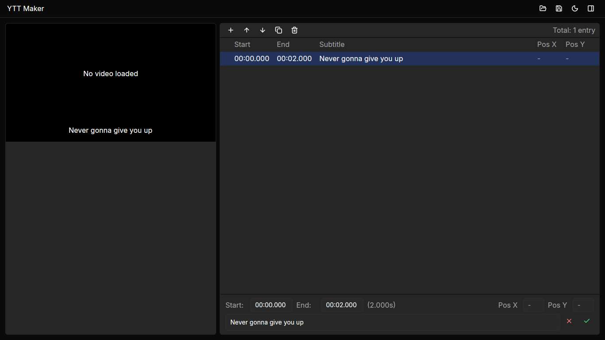

# YTTM - YouTube Timed Text Maker

A tool to edit YouTube subtitle, written in Rust using GPUI.

> [!NOTE]
> The project is still in work in progress stage

Have you ever watched some music video with subtitle and are surprised that the
subtitle can have special color/background and/or can move freely on the screen?

If you haven't, here is [one example](https://youtu.be/NTrm_idbhUk) (turn on `English` subtitle)

If you have, it's called YouTube Timed Text (`.ytt` format), and this is the tool to make it.

## Current app preview

|  display") |  |
| ----------------------------------------------------------------- | -------------------------------------------------------------- |
| Default (stacked) display                                         | Side by side display                                           |

## Q/A

- Q: If this tool wasn't complete, what were they using to make the subtitle?
- A: I used to use Aegisub to make the subtitle for some videos and then use a tool to convert
  from their `.ass` format (nice extension) to `.ytt` format.

- Q: If Aegisub just worked, why not just use Aegisub?
- A: It worked, but Aegisub is mainly for subtitle that can have various effects/features that
  YouTube subtitle doesn't support. And also you have to use an extra conversion tool after.

## License

This project is licensed under the [`Zlib license`](LICENSE).
